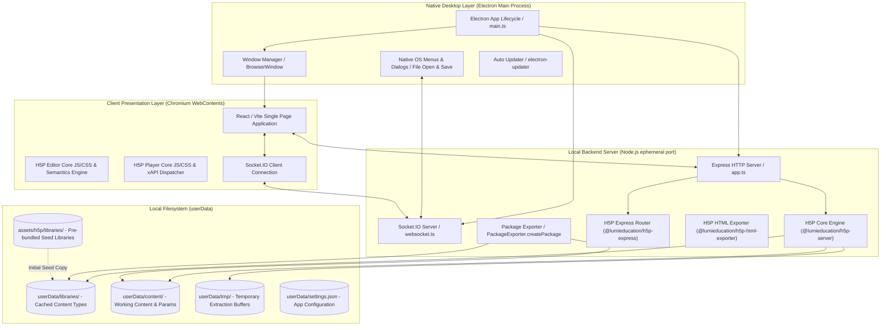
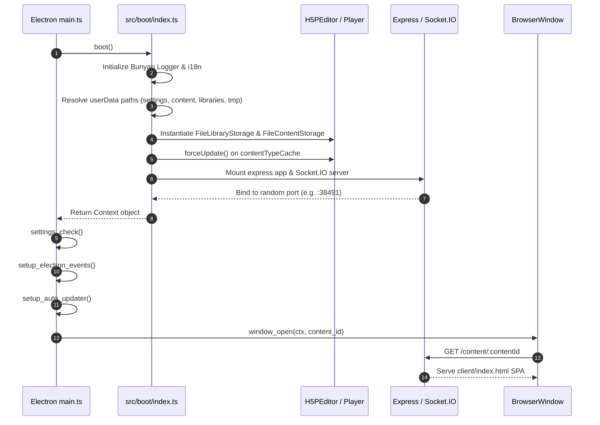
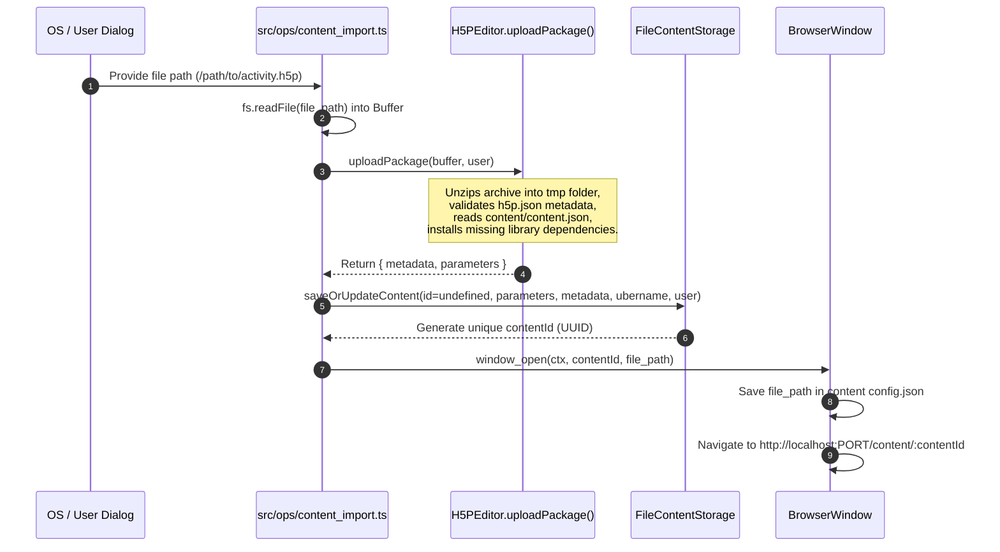
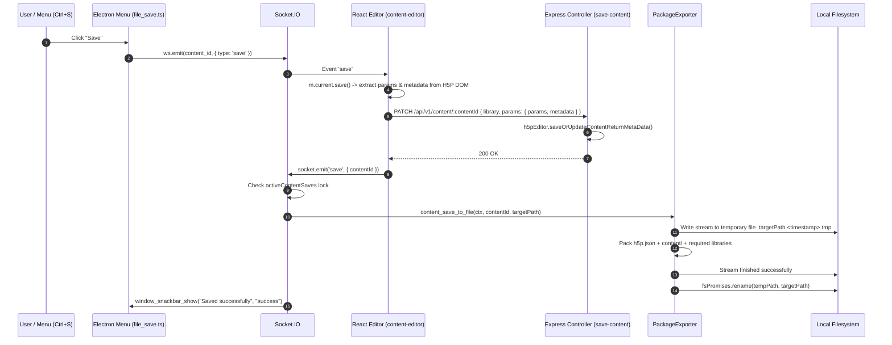
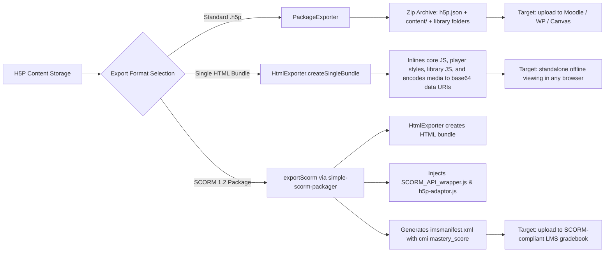
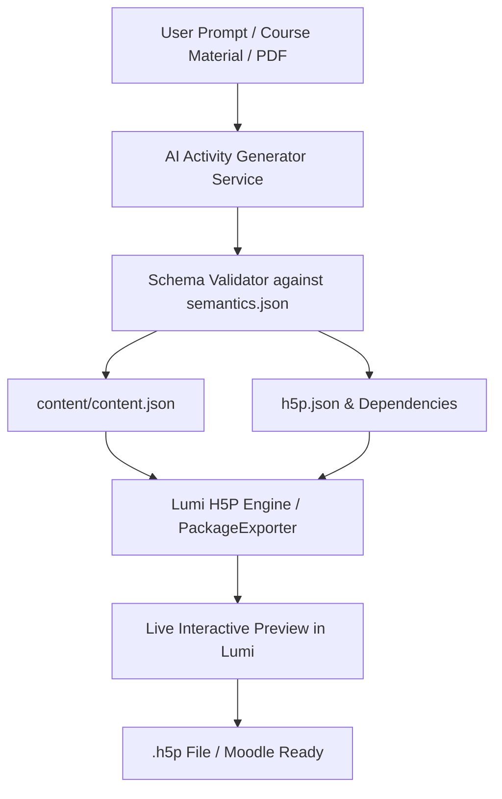

# Lumi Desktop Editor — Technical Architecture & Developer Guide

> **Offline H5P Authoring & Packaging Platform**  
> *Build, edit, preview, and package rich interactive H5P activities completely offline — without dependency on h5p.org, Drupal, WordPress, or Moodle.*

---

## Table of Contents

1. [Executive Overview & Core Value Proposition](#1-executive-overview--core-value-proposition)
2. [High-Level Architecture & Tech Stack](#2-high-level-architecture--tech-stack)
3. [Component Breakdown](#3-component-breakdown)
   - [Electron Main & Window Management](#electron-main--window-management)
   - [Embedded Express Server](#embedded-express-server)
   - [Socket.IO WebSocket Layer](#socketio-websocket-layer)
   - [H5P Server & Storage Engines](#h5p-server--storage-engines)
   - [Client Web Single-Page Application (SPA)](#client-web-single-page-application-spa)
   - [Bundled Offline Library Repository](#bundled-offline-library-repository)
4. [End-to-End Execution & Data Flows](#4-end-to-end-execution--data-flows)
   - [Application Boot Sequence](#application-boot-sequence)
   - [Opening & Importing `.h5p` Files](#opening--importing-h5p-files)
   - [Content Editing & Form Parameter Serialization](#content-editing--form-parameter-serialization)
   - [Save & Save-As Pipeline (Anti-Corruption Lock)](#save--save-as-pipeline-anti-corruption-lock)
   - [Multi-Format Export Pipelines (.h5p, HTML, SCORM 1.2)](#multi-format-export-pipelines-h5p-html-scorm-12)
5. [Deep Dive: H5P Internal Specification & Data Model](#5-deep-dive-h5p-internal-specification--data-model)
   - [Anatomy of a `.h5p` Archive](#anatomy-of-a-h5p-archive)
   - [The `semantics.json` Meta-Schema](#the-semanticsjson-meta-schema)
   - [Dependency Resolution & Ubernames](#dependency-resolution--ubernames)
   - [xAPI Event Dispatcher & Scoring Bridge](#xapi-event-dispatcher--scoring-bridge)
6. [AI Integration Blueprint (Adding AI Activity Generation)](#6-ai-integration-blueprint-adding-ai-activity-generation)
   - [Why H5P is Ideal for Generative AI](#why-h5p-is-ideal-for-generative-ai)
   - [Proposed AI Feature Set](#proposed-ai-feature-set)
   - [Architecture for AI Generation Service](#architecture-for-ai-generation-service)
   - [Schema-Constrained Generation Prompts](#schema-constrained-generation-prompts)
7. [Moodle Plugin Blueprint (Extracting Logic for Moodle)](#7-moodle-plugin-blueprint-extracting-logic-for-moodle)
   - [How Moodle Handles H5P vs. Lumi](#how-moodle-handles-h5p-vs-lumi)
   - [Proposed Moodle Plugin Architecture (`local_ai_h5p`)](#proposed-moodle-plugin-architecture-local_ai_h5p)
   - [Native PHP Package Assembly using Moodle APIs](#native-php-package-assembly-using-moodle-apis)
   - [Direct Deployment into Courses & Content Bank](#direct-deployment-into-courses--content-bank)
8. [Codebase Directory & Module Reference](#8-codebase-directory--module-reference)
9. [Developer Setup, Build, and Packaging](#9-developer-setup-build-and-packaging)

---

## 1. Executive Overview & Core Value Proposition

**Lumi** is a cross-platform desktop application built on **Electron**, **Node.js**, and **TypeScript**. Its primary goal is to provide a fully offline, sovereign environment for creating, editing, displaying, and exporting interactive learning content conforming to the open [H5P specification](https://h5p.org).

### The Problem Lumi Solves
Traditionally, creating an H5P activity required one of the following:
1. An account on **H5P.org** (limited, test-only) or **H5P.com** (costly enterprise SaaS).
2. A live Learning Management System (LMS) such as **Moodle**, **Canvas**, or a CMS like **WordPress** or **Drupal** running the H5P plugin.

This created high barriers: educators and instructional designers could not draft activities offline, couldn't batch-edit without administrative server privileges, and risked losing work when connectivity dropped.

### Core Capabilities
* **100% Offline Editing**: Bundles over 140 H5P content types (Interactive Video, Course Presentation, Branching Scenario, Fill in the Blanks, Multiple Choice, etc.) locally.
* **Direct File Associations**: Associates with `.h5p` files on macOS, Windows, and Linux. Double-clicking any `.h5p` file opens it instantly in Lumi.
* **Universal Exporting**:
  * **Standard `.h5p`**: Portable archive fully compatible with Moodle Content Bank, WordPress, Drupal, and any LMS supporting H5P.
  * **Standalone HTML Bundle**: Single, zero-dependency HTML file with all JS, CSS, and base64-encoded media inlined; runs in any browser without web servers.
  * **SCORM 1.2 Package**: Standard SCORM zip archive with an embedded xAPI-to-SCORM CMI bridge (`h5p-adaptor.js`) reporting grades back to LMS gradebooks.

---

## 2. High-Level Architecture & Tech Stack

Lumi employs a hybrid architecture: an **Electron native desktop wrapper** hosting a local **Node.js Express HTTP server** and a **Socket.IO WebSocket server**, communicating with a **React-based Single Page Application (SPA)** rendered inside an Electron `BrowserWindow`.



### Core Technologies
* **Runtime**: Electron 34, Node.js 20+, TypeScript 5.6
* **H5P Core**: `@lumieducation/h5p-server` (v9.3.3) — open-source pure TypeScript implementation of H5P server specifications.
* **HTTP & Static Engine**: Express 4.21, `express-fileupload`, `body-parser`
* **Real-Time RPC**: Socket.IO 4.8
* **Packaging & Export**: `simple-scorm-packager`, `adm-zip` / stream zip packaging, `@lumieducation/h5p-html-exporter`
* **Logging & I18n**: Bunyan logger, `i18next` with multi-namespace localization support.

---

## 3. Component Breakdown

### Electron Main & Window Management
Located in `src/main.ts`, `src/events/app/`, and `src/ops/window_*.ts`.
* Coordinates application startup, handles command-line arguments (e.g. file paths passed when opening `.h5p` files), and monitors window events.
* Each open H5P activity runs in its own `BrowserWindow` instance loaded with:
  `http://localhost:<port>/content/<contentId>` (or `/content/new` for blank activities).
* Binds the application menu (`src/menu/`) with native accelerators (`CmdOrCtrl+S`, `CmdOrCtrl+O`, etc.) and routes actions to the active window via WebSocket signals.

### Embedded Express Server
Located in `src/express/app.ts` and `src/express/controller/`.
* Spawns on an **ephemeral local port** (in production `server.listen(0)`) or port 3000 in development.
* Endpoints:
  | Method | Path | Description |
  |---|---|---|
  | `GET` | `/api/v1/content/:contentId/render` | Returns rendered HTML for previewing content in an iframe with required CSS/JS links. |
  | `GET` | `/api/v1/content/:contentId/edit` | Fetches H5P editor initialization model, content parameters, and library metadata. |
  | `PATCH` | `/api/v1/content/:contentId` | Persists edited parameters (`content.json`) and metadata (`h5p.json`) to local content storage. |
  | `GET` | `/api/v1/settings` | Returns app configuration (theme, language, Hub endpoints). |
  | `USE` | `/api/v1/libraries` | Mounts `libraryAdministrationExpressRouter` from `@lumieducation/h5p-express`. |
  | `USE` | `/h5p` (or `baseUrl`) | Mounts `h5pAjaxExpressRouter` handling H5P Editor AJAX operations (content-type hub queries, library loading, file uploads). |
  | `GET` | `*` | Serves client static assets and falls back to `client/index.html` (SPA routing). |

### Socket.IO WebSocket Layer
Located in `src/boot/websocket.ts` and `src/events/websocket/`.
* Solves the IPC gap between native Electron window menus and the web editor running inside the browser view.
* Handlers include:
  * `save`: Coordinates saving the current active content to its file path.
  * `save_as`: Prompts for a file destination and writes the `.h5p` archive.
  * `export_as_html` & `export_as_html_external`: Generates single-file or multi-file HTML packages.
  * `export_as_scorm`: Triggers SCORM 1.2 zip generation.
  * `setup`: Manages initial setup dialog and seeds offline libraries.
  * `language_change`: Dynamically switches i18n locales.

### H5P Server & Storage Engines
Located in `src/boot/h5p-editor.ts` and `src/boot/h5p-player.ts`.
Instantiates `@lumieducation/h5p-server` interfaces:
* **`FileLibraryStorage` & `CachedLibraryStorage`**: Manages installed H5P content types in `userData/libraries/`.
* **`FileContentStorage`**: Stores raw content folders (`userData/content/<contentId>/` containing `content/content.json` and media files).
* **`DirectoryTemporaryFileStorage`**: Handles file uploads and temporary extraction during imports (`userData/tmp/`).
* **`H5PURLGenerator`**: Custom URL resolver that maps assets, libraries, and AJAX endpoints to the embedded Express server.

### Client Web Single-Page Application (SPA)
Located in `client/` (`client/index.html` and `client/assets/*.js`).
* Built as a modern React single-page application.
* Loads H5P's official web editor scripts (`assets/h5p/editor/`) and player scripts (`assets/h5p/core/`).
* Directly executes `ns.instances[0].getParams()` and `ns.instances[0].getLibrary()` to extract JSON parameter state from the DOM forms before emitting save requests.

### Bundled Offline Library Repository
Located in `assets/h5p/libraries/`.
* Contains 146 pre-extracted H5P content-type libraries (e.g. `H5P.InteractiveVideo-1.24`, `H5P.CoursePresentation-1.26`, `H5P.MultiChoice-1.16`).
* When building production installers, `builder.config.js` configures `asarUnpack: ['assets/h5p/libraries/**']`.
* On first launch or via settings, `libraries_copy.ts` copies these libraries directly into `userData/libraries`, granting full offline authoring without downloading anything from the internet.

---

## 4. End-to-End Execution & Data Flows

### Application Boot Sequence



---

### Opening & Importing `.h5p` Files

When a user double-clicks an `.h5p` file or selects **File > Open**:



---

### Content Editing & Form Parameter Serialization

1. When `/content/:contentId` loads, the React client requests `GET /api/v1/content/:contentId/edit`.
2. Express calls `h5pEditor.render(contentId)`.
3. The server inspects the content's main library (e.g. `H5P.MultiChoice 1.16`), reads its `semantics.json` file, and returns the editor model.
4. The client initializes H5P's client-side editor widget:
   ```javascript
   H5PEditor.init(
     $form,
     $commonFields,
     $topEditor,
     library,
     params,
     metadata
   );
   ```
5. The H5P editor parses `semantics.json` and dynamically generates the form fields (text boxes, wysiwyg editors, select menus, repeaters).
6. When the user changes fields, the form maintains internal state in `H5PEditor.instances[0]`.

---

### Save & Save-As Pipeline (Anti-Corruption Lock)

To avoid corrupted `.h5p` files if a write is interrupted, Lumi implements an atomic saving mechanism:



---

### Multi-Format Export Pipelines (.h5p, HTML, SCORM 1.2)

From the **File > Export** menu, three formats are supported (`src/ops/export-h5p.ts`):



---

## 5. Deep Dive: H5P Internal Specification & Data Model

### Anatomy of a `.h5p` Archive
A `.h5p` file is a standard ZIP archive with a specific structure:

```
my-quiz.h5p
├── h5p.json                          <-- Package descriptor and dependency manifest
├── content/
│   ├── content.json                  <-- Serialized parameters matching semantics.json
│   ├── images/                       <-- Referenced image assets
│   ├── videos/                       <-- Referenced video assets
│   └── audios/                       <-- Referenced audio clips
├── H5P.MultiChoice-1.16/             <-- Dependency library folder
│   ├── library.json                  <-- Library version & dependencies
│   ├── semantics.json                <-- Parameter definition schema
│   ├── js/multichoice.js             <-- Client runtime script
│   └── css/multichoice.css           <-- Stylesheet
└── FontAwesome-4.5/                  <-- Nested dependency library
    ├── library.json
    └── ...
```

#### The `h5p.json` Manifest
```json
{
  "title": "Solar System Quiz",
  "language": "en",
  "mainLibrary": "H5P.MultiChoice",
  "embedTypes": ["iframe"],
  "license": "CC BY 4.0",
  "defaultLanguage": "en",
  "preloadedDependencies": [
    { "machineName": "H5P.MultiChoice", "majorVersion": 1, "minorVersion": 16 },
    { "machineName": "FontAwesome", "majorVersion": 4, "minorVersion": 5 },
    { "machineName": "H5P.JoubelUI", "majorVersion": 1, "minorVersion": 3 },
    { "machineName": "H5P.Question", "majorVersion": 1, "minorVersion": 5 }
  ]
}
```

---

### The `semantics.json` Meta-Schema
Every H5P content type defines a `semantics.json` file in its root. This is the **formal specification** that dictates what data can exist inside `content/content.json`.

Supported field types:
* `text`: Single line or rich HTML text (via CKEditor widget).
* `number`: Integers or decimals with min, max, and step validation.
* `boolean`: Toggle switch / checkbox.
* `list`: Repeatable collection of elements (e.g. array of answers).
* `group`: Nested object grouping multiple fields together.
* `select`: Dropdown selection of predefined options.
* `library`: Sub-content type embedding another H5P library (e.g. embedding an Image or Video inside a Question).
* `image`, `video`, `audio`, `file`: Media references with mime types and dimensions.

#### Example: `content/content.json` generated for `H5P.MultiChoice-1.16`
```json
{
  "question": "<p>Which planet is known as the Red Planet?</p>",
  "answers": [
    {
      "text": "<div>Mars</div>",
      "correct": true,
      "tipsAndFeedback": {
        "tip": "Named after the Roman god of war."
      }
    },
    {
      "text": "<div>Jupiter</div>",
      "correct": false,
      "tipsAndFeedback": {
        "tip": "This is the largest planet, not the red one."
      }
    }
  ],
  "behaviour": {
    "enableRetry": true,
    "enableSolutionsButton": true,
    "singlePoint": true,
    "randomAnswers": true,
    "showSolutionsRequiresInput": true,
    "type": "auto"
  },
  "media": {
    "disableImageZooming": false
  }
}
```

---

### Dependency Resolution & Ubernames
H5P uses a semantic naming convention called an **Ubername**:
$$\text{Ubername} = \text{machineName} + \text{" "} + \text{majorVersion} + \text{"."} + \text{minorVersion}$$
Example: `H5P.InteractiveVideo 1.24`

When Lumi or Moodle loads an activity:
1. It reads `mainLibrary` from `h5p.json`.
2. It looks up the corresponding `preloadedDependencies` matching that machine name.
3. It recursively resolves all child dependencies declared in each library's `library.json`.
4. It loads scripts and styles in strict topological dependency order.

---

### xAPI Event Dispatcher & Scoring Bridge
H5P activities communicate student interactions using **xAPI (Experience API / Tin Can API)** statements.
At runtime, the global dispatcher `H5P.externalDispatcher` emits events:
```javascript
H5P.externalDispatcher.on('xAPI', function (event) {
  const statement = event.data.statement;
  if (statement.result) {
    // statement.result.score.scaled (0.0 to 1.0)
    // statement.result.score.raw
    // statement.result.completion
    // statement.result.success
  }
});
```
In SCORM export (`assets/scorm-client/h5p-adaptor.js`), Lumi catches these events and writes them directly into the SCORM CMI data model:
* `cmi.core.score.raw` = $\text{scaled} \times 100$
* `cmi.core.lesson_status` = `passed` or `failed` (compared against `masteryScore`).

---

## 6. AI Integration Blueprint (Adding AI Activity Generation)

### Why H5P is Ideal for Generative AI
Unlike opaque quiz engines or unstructured LMS forms, H5P is uniquely tailored for AI automation:
1. **Deterministic Schema**: Every content type's valid state is defined in `semantics.json`.
2. **Self-Contained JSON**: An entire activity is completely represented by one JSON object (`content.json`) and one metadata manifest (`h5p.json`).
3. **High Pedagogical Variety**: AI can generate flashcards, interactive videos, drag-and-drops, branched scenarios, or interactive books through the same JSON generation paradigm.

### Proposed AI Feature Set



1. **Text/Prompt to H5P**:
   * Example: *"Create a 5-question multiple choice quiz with hints and explanations about Photosynthesis for Grade 10."*
   * AI outputs structured `H5P.MultiChoice` parameters.
2. **Document to H5P Activity (Course Material Converter)**:
   * Upload a lecture PDF or chapter Markdown.
   * AI automatically extracts key concepts, generates `H5P.Dialogcards`, `H5P.Blanks`, and `H5P.CoursePresentation` summary slides.
3. **Interactive Video Auto-Annotator**:
   * Given a YouTube URL or MP4 transcript with timestamps, AI generates timestamped quiz checkpoints (`H5P.InteractiveVideo`) to test understanding at key video moments.
4. **Smart Distractor & Feedback Generator**:
   * Within the editor, add an "AI Enhance" button that writes plausible wrong answer choices and pedagogical feedback for existing questions.

---

### Architecture for AI Generation Service

Add an AI controller in Express (`src/express/controller/ai-generate.ts`):

```typescript
// Proposed Route: POST /api/v1/ai/generate
import { Router } from 'express';
import { generateH5PFromPrompt } from '../../ai/service';

const router = Router();

router.post('/api/v1/ai/generate', async (req, res) => {
  const { prompt, contentType, options } = req.body;
  
  // 1. Fetch semantics.json for target library
  const semantics = await req.ctx.h5pEditor.libraryStorage.getFileAsString(
    contentType, // e.g. "H5P.MultiChoice-1.16"
    'semantics.json'
  );

  // 2. Call LLM with JSON Schema enforcement
  const generatedParams = await generateH5PFromPrompt({
    prompt,
    semantics: JSON.parse(semantics),
    provider: req.body.provider ?? 'gemini' // gemini / openai / anthropic / ollama
  });

  // 3. Save new content in storage
  const { id } = await req.ctx.h5pEditor.saveOrUpdateContent(
    undefined,
    generatedParams,
    { title: req.body.title ?? 'AI Generated Content' },
    contentType,
    req.user
  );

  res.json({ contentId: id });
});
```

---

### Schema-Constrained Generation Prompts
To guarantee zero-shot generation of syntactically valid H5P content, the LLM is given the library's `semantics.json` transformed into a TypeScript or JSON Schema:

```markdown
You are an expert instructional designer and H5P engineer.
Generate an H5P activity for library "H5P.MultiChoice 1.16".

Strictly output ONLY a valid JSON object matching the following structure:
{
  "question": "<p>HTML question text</p>",
  "answers": [
    {
      "text": "<div>Option text</div>",
      "correct": boolean,
      "tipsAndFeedback": {
        "tip": "Pedagogical hint for student",
        "chosenFeedback": "Explanation if selected"
      }
    }
  ],
  "behaviour": {
    "enableRetry": true,
    "enableSolutionsButton": true,
    "singlePoint": true,
    "randomAnswers": true
  }
}
```

---

## 7. Moodle Plugin Blueprint (Extracting Logic for Moodle)

### How Moodle Handles H5P vs. Lumi

| Feature | Lumi Desktop | Moodle Core (`core_h5p`) |
|---|---|---|
| **Runtime Environment** | Node.js + Electron | PHP 8.x + MySQL/PostgreSQL |
| **Library Management** | `userData/libraries/` (File system) | Database tables: `mdl_h5p`, `mdl_h5p_libraries` |
| **Content Storage** | `userData/content/<id>/` (File system) | Moodle File API (`contenthash` in `moodledata`) |
| **Authoring Interface** | Embedded Client SPA + Joubel Editor | Moodle Content Bank (`core_contentbank`) |
| **Offline Support** | 100% Offline | Requires connection to Moodle server |

---

### Proposed Moodle Plugin Architecture (`local_ai_h5p`)

You can port the generation and packaging logic from Lumi directly into a native Moodle plugin:

```
moodle/local/ai_h5p/
├── classes/
│   ├── generator.php           <-- Coordinates AI prompt calls
│   ├── package_builder.php     <-- Builds .h5p package directly in PHP
│   ├── schema_mapper.php       <-- Maps learning objectives to H5P semantics
│   └── privacy/provider.php    <-- Moodle GDPR compliance
├── db/
│   ├── access.php              <-- Capabilities (local/ai_h5p:generate)
│   └── services.php            <-- Moodle Mobile / External API definitions
├── templates/
│   └── generator_modal.mustache<-- Bootstrap modal in Course & Content Bank
├── lang/en/local_ai_h5p.php    <-- Strings
└── version.php
```

---

### Native PHP Package Assembly using Moodle APIs
Because Moodle 3.9+ includes `core_h5p`, you do **not** need Node.js on the Moodle server! You can assemble valid H5P packages natively in PHP:

```php
namespace local_ai_h5p;

defined('MOODLE_INTERNAL') || die();

class package_builder {
    /**
     * Creates an in-memory or temporary .h5p zip file from AI-generated parameters.
     */
    public static function create_h5p_file(string $title, string $mainlibrary, array $params): \stored_file {
        global $CFG, $USER;
        require_once($CFG->libdir . '/filestorage/zip_packer.php');

        $tempdir = make_request_directory();

        // 1. Build h5p.json
        $h5pjson = [
            'title' => $title,
            'language' => current_language(),
            'mainLibrary' => $mainlibrary,
            'embedTypes' => ['iframe'],
            'preloadedDependencies' => self::get_library_dependencies($mainlibrary)
        ];
        file_put_contents($tempdir . '/h5p.json', json_encode($h5pjson, JSON_PRETTY_PRINT));

        // 2. Build content/content.json
        mkdir($tempdir . '/content');
        file_put_contents($tempdir . '/content/content.json', json_encode($params, JSON_PRETTY_PRINT));

        // 3. Copy required library files from Moodle's H5P storage
        self::export_libraries_to_dir($h5pjson['preloadedDependencies'], $tempdir);

        // 4. Zip archive
        $zippath = $tempdir . '/activity.h5p';
        $packer = get_file_packer('application/zip');
        $files = [
            'h5p.json' => $tempdir . '/h5p.json',
            'content/content.json' => $tempdir . '/content/content.json'
        ];
        // Add all library files to zip array...
        $packer->archive_to_pathname($files, $zippath);

        // 5. Store file in Moodle user draft area or Content Bank
        $fs = get_file_storage();
        $record = [
            'contextid' => \context_user::instance($USER->id)->id,
            'component' => 'user',
            'filearea'  => 'draft',
            'itemid'    => file_get_unused_draft_itemid(),
            'filepath'  => '/',
            'filename'  => clean_filename($title) . '.h5p'
        ];
        return $fs->create_file_from_pathname($record, $zippath);
    }
}
```

---

### Direct Deployment into Courses & Content Bank
Once the `.h5p` file is created:
1. **Save to Moodle Content Bank**:
   ```php
   $cb = new \core_contentbank\contentbank();
   $content = $cb->create_content_from_file($context, $USER->id, $storedfile);
   ```
2. **Deploy as `mod_h5p` Activity in Course**:
   The plugin can programmatically invoke `add_moduleinfo()` to insert a new H5P activity directly into any course section, pre-linked to the generated package.

---

## 8. Codebase Directory & Module Reference

```
Lumi/
├── assets/                           <-- Static branding, scorm wrappers, offline libraries
│   ├── h5p/
│   │   ├── core/                     <-- Official H5P player runtime JS & CSS
│   │   ├── editor/                   <-- Official H5P editor widgets & semantics renderer
│   │   └── libraries/                <-- 146 pre-bundled offline H5P libraries
│   ├── scorm-client/                 <-- SCORM 1.2 wrapper and xAPI event adapter
│   └── translations/                 <-- Multi-language localization dictionaries
├── client/                           <-- Compiled React Single Page Application (SPA)
│   ├── assets/                       <-- Compiled JS & CSS bundles
│   └── index.html                    <-- HTML shell mounting the React app
├── config/
│   ├── default_settings.ts           <-- Default preferences (theme, language, Hub URL)
│   └── h5p-config.ts                 <-- Implements IH5PConfig for @lumieducation/h5p-server
├── src/
│   ├── boot/                         <-- Core system initializers
│   │   ├── h5p-editor.ts             <-- Configures H5PEditor with FileStorage & UrlGenerator
│   │   ├── h5p-player.ts             <-- Configures H5PPlayer
│   │   ├── i18n.ts                   <-- Initializes i18next
│   │   ├── index.ts                  <-- Main boot orchestrator (creates Express + WS)
│   │   ├── log.ts                    <-- Bunyan logger configuration
│   │   └── websocket.ts              <-- Attaches Socket.IO to HTTP server
│   ├── events/                       <-- Event listener registrations
│   │   ├── app/                      <-- Electron lifecycle (ready, will-quit, open-file)
│   │   ├── autoUpdater/              <-- In-app update check and background download
│   │   ├── websocket/                <-- Socket.IO RPC handlers (save, export, settings)
│   │   └── window/                   <-- BrowserWindow focus and close events
│   ├── express/                      <-- Local web server
│   │   ├── app.ts                    <-- Configures Express middlewares and static routes
│   │   ├── Request.ts                <-- Express Request interface extensions
│   │   ├── controller/               <-- API routes (/content/edit, /render, /save)
│   │   └── utils/                    <-- HTML renderer & user mocks
│   ├── implementations/
│   │   └── H5PURLGenerator.ts        <-- Custom URL generator for H5P server
│   ├── menu/                         <-- Electron native OS menus (File, Edit, View, Help)
│   │   └── file/                     <-- file_open, file_save, file_save_as, file_export
│   ├── models/
│   │   └── User.ts                   <-- Local dummy user model satisfying IUser
│   ├── ops/                          <-- Business operations & atomic actions
│   │   ├── content_config_read.ts    <-- Reads content-specific metadata
│   │   ├── content_config_write.ts   <-- Updates content-specific metadata
│   │   ├── content_delete.ts         <-- Deletes content folder from disk
│   │   ├── content_export_as_html.ts <-- Bundles content into single HTML file
│   │   ├── content_export_as_scorm.ts<-- Packages content into SCORM 1.2 zip
│   │   ├── content_import.ts         <-- Unpacks .h5p archive into local storage
│   │   ├── content_save_to_file.ts   <-- Uses PackageExporter to write .h5p archive
│   │   ├── export-h5p.ts             <-- Core export engine coordinating HtmlExporter
│   │   ├── libraries_copy.ts         <-- Copies pre-bundled libraries to userData
│   │   ├── window_open.ts            <-- Creates new BrowserWindow and binds events
│   │   └── templates/                <-- HTML & SCORM export templates
│   ├── types/                        <-- TypeScript definitions (Settings, MenuItem)
│   └── main.ts                       <-- Electron application entry point
├── builder.config.js                 <-- electron-builder configuration (mac, win, linux)
├── package.json                      <-- Project dependencies and scripts
└── tsconfig.json                     <-- TypeScript compiler configuration
```

---

## 9. Developer Setup, Build, and Packaging

### Prerequisites
* **Node.js**: v18.x or v20.x
* **npm**: v9.x or v10.x
* **Build Essentials**: Python 3 and C++ compiler (for native node modules if applicable)

### Installation & Local Run
```bash
# 1. Clone repository
git clone https://github.com/Smartlearn-edu/Lumi.git
cd Lumi

# 2. Install dependencies
npm install

# 3. Compile TypeScript
npm run build

# 4. Start Electron desktop application
npm start
```

### Packaging Desktop Installers
Lumi uses `electron-builder` to produce standalone installers:

```bash
# Linux (AppImage, deb)
npm run build:linux

# macOS (DMG, Zip - Universal or x64/arm64)
npm run build:mac

# Windows (NSIS installer, APPX)
npm run build:win
```

### Code Quality & Formatting
```bash
# Run ESLint across src
npm run lint

# Auto-fix linting issues
npm run lint:fix

# Format codebase with Prettier
npm run format
```

---

## Summary of Extension Opportunities
1. **AI Copilot inside Lumi**: Add `/api/v1/ai/generate` to Express in `src/express/app.ts` and attach an interactive AI Assistant panel to the React SPA in `client/`.
2. **Batch Converter CLI**: Extract `src/ops/content_import.ts` and `src/ops/content_save_to_file.ts` into a headless Node CLI that converts Markdown, CSV, or raw question banks into `.h5p` packages automatically.
3. **Moodle AI Activity Generator (`local_ai_h5p`)**: Replicate the H5P parameter composition and packaging logic in PHP to allow teachers to prompt-generate activities directly within Moodle courses without any desktop software.
