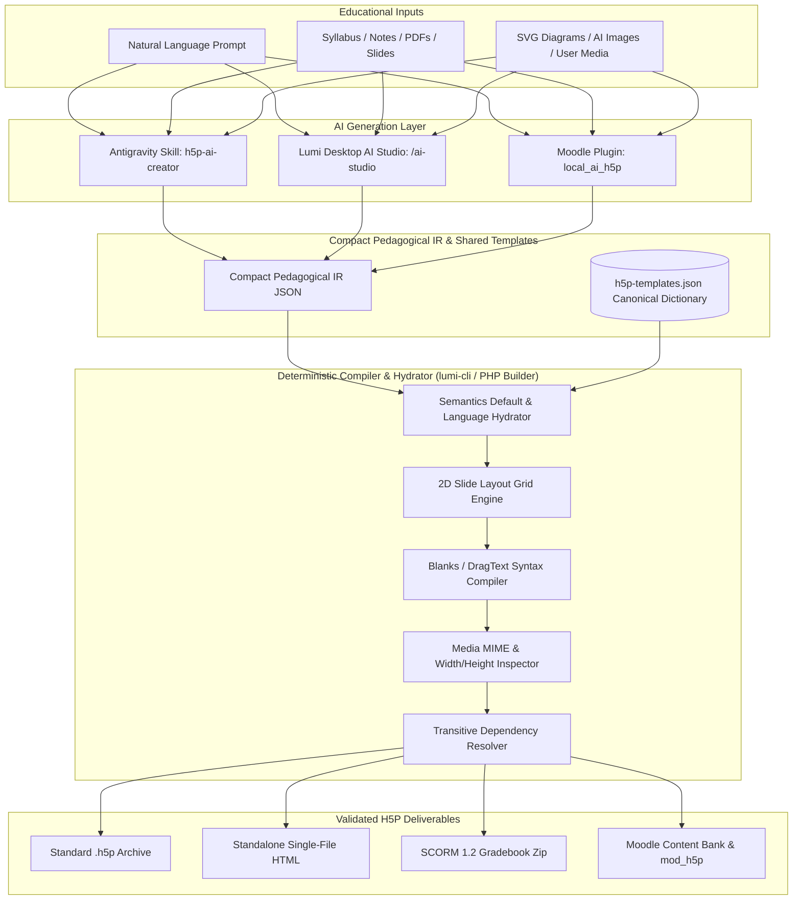
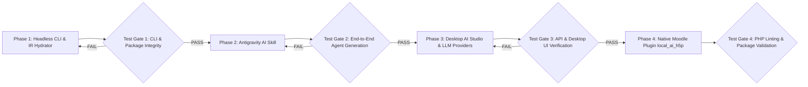

# Technical Master Blueprint (v2 — Hardened Architecture & Test-Gated Plan)
**Lumi Headless Compiler CLI • IR Hydrator • Antigravity AI Skill • Desktop AI Studio • Native Moodle Plugin**

---

## 1. Executive Vision & Hardened Architecture (v2)

Following our architectural critique, **v2 of the Master Blueprint** eliminates the 7 failure modes of naive LLM-to-H5P generation by introducing a **Deterministic Intermediate Representation (IR) Compiler, Semantics Hydrator, Slide Layout Grid Engine, and Shared Canonical Template Dictionary (`h5p-templates.json`)**.

### Why the IR Compiler & Hydrator Layer is Mandatory
1. **Zero UI/L10n Crashes**: Over 60% of H5P `semantics.json` files consist of `"common": true` UI strings (`ui.checkAnswerButton`, `confirmCheck`, `a11yCheck`) and default `behaviour` flags. The **Hydrator** walks `semantics.json` and `language/<lang>.json` to automatically inject all required defaults so the LLM only generates pure pedagogical content.
2. **90% Token Reduction for Local & Cloud LLMs**: Instead of feeding 40,000-token recursive `semantics.json` trees into an LLM, the LLM targets a compact, 50-line **Pedagogical IR Schema**, making even small local Ollama models (`llama3.2`) fast and reliable.
3. **Deterministic Sub-Library Wrappers**: The compiler automatically generates UUIDv4 `subContentId`s, attaches `{ "contentType": "...", "license": "U", "title": "..." }` metadata blocks, and resolves exact `major.minor` library versions from `assets/h5p/libraries/`.
4. **Deterministic 2D Slide Layouts**: For `H5P.CoursePresentation`, the **Slide Layout Grid Engine** translates semantic layouts (`title-slide`, `two-column`, `text-left-image-right`, `full-slide-quiz`) into exact `x, y, width, height` canvas percentages—eliminating overlapping boxes.
5. **Micro-Syntax Sanitization**: For `H5P.Blanks`, `H5P.DragText`, and `H5P.MarkTheWords`, the compiler converts structured JSON arrays into properly escaped `*answer/alt:tip*` strings.
6. **Automatic Media MIME & Dimension Inspection**: Reads PNG, JPEG, SVG, WebP, MP3, and MP4 headers in `content/` to inject accurate `mime`, `width`, and `height` properties into `content.json`.
7. **Zero Code Duplication Between TypeScript & PHP**: `lumi-cli` exports a pre-hydrated **`h5p-templates.json`** dictionary that both Lumi (Node.js) and the Moodle Plugin (`local_ai_h5p` in PHP) consume directly.



---

## 2. Core Technical Specifications by Component

### Component 1: Headless Compiler CLI & IR Hydrator (`src/cli/`)
* **Entrypoint**: `src/cli.ts` (compiled to `build/src/cli.js`, exposed as `lumi-cli`).
* **Zero-Electron Execution**: Avoids importing `electron` at the top level of CLI modules so `node build/src/cli.js` runs headlessly in any terminal, CI runner, or agent subshell without an X11/Wayland display server.
* **Commands**:
  1. `lumi-cli list [--runnable] [--search <query>]`: Lists all 146 bundled libraries in `assets/h5p/libraries/` with their exact `machineName`, `majorVersion.minorVersion.patchVersion`, and `title`.
  2. `lumi-cli schema <library> [--ir | --raw]`:
     * `--ir` (default): Outputs the compact **Pedagogical IR JSON Schema** + example prompt payload for AI consumption.
     * `--raw`: Outputs the raw `semantics.json` from `assets/h5p/libraries/`.
  3. `lumi-cli compile <ir-file.json> -o <output.h5p> [-f h5p|html|scorm] [--lang en]`:
     * Compiles a compact Pedagogical IR file (and any local media paths referenced in it) through the **Semantics Hydrator**, **Slide Layout Engine**, **Micro-Syntax Compiler**, and **Media Inspector**, then packs it into `.h5p`, standalone `.html`, or SCORM `.zip`.
  4. `lumi-cli pack <dir> -o <output.h5p> [-f h5p|html|scorm] [--hydrate]`:
     * Packs a directory containing `content/content.json`, optional `h5p.json`, and media files. With `--hydrate` (default on), fills in any missing default semantics fields and resolves all transitive `preloadedDependencies` automatically.
  5. `lumi-cli unpack <file.h5p> -o <dir>`:
     * Extracts `.h5p` into `h5p.json`, `content/content.json`, and media folders.
  6. `lumi-cli validate <dir-or-ir.json>`:
     * Verifies all required fields, sub-library ubernames, media file existence, and transitive dependencies.
  7. `lumi-cli export-templates -o assets/h5p-templates.json`:
     * Pre-computes the canonical template dictionary used by both TypeScript and the PHP Moodle plugin.

---

### Component 2: Compact Pedagogical IR Specification
Instead of messy H5P internals, the AI generates clean, human-readable IR JSON:

```json
{
  "title": "Photosynthesis & Cellular Energy",
  "language": "en",
  "type": "H5P.CoursePresentation",
  "slides": [
    {
      "layout": "text-left-image-right",
      "title": "Chloroplast Structure",
      "html": "<ul><li><strong>Thylakoids</strong>: Light-dependent reactions</li><li><strong>Stroma</strong>: Calvin cycle</li></ul>",
      "image": {
        "src": "./chloroplast.svg",
        "alt": "Diagram of a plant chloroplast"
      }
    },
    {
      "layout": "full-slide-quiz",
      "activity": {
        "type": "H5P.MultiChoice",
        "question": "Where does the Calvin cycle take place?",
        "answers": [
          { "text": "Stroma", "correct": true, "feedback": "Correct! The stroma hosts the light-independent reactions." },
          { "text": "Thylakoid lumen", "correct": false, "feedback": "Review where light-dependent reactions occur." }
        ]
      }
    },
    {
      "layout": "full-slide-quiz",
      "activity": {
        "type": "H5P.Blanks",
        "taskDescription": "Complete the chemical summary:",
        "sentences": [
          {
            "text": "Plants convert {{0}} and water into {{1}} and oxygen.",
            "blanks": [
              { "accepted": ["carbon dioxide", "CO2"], "hint": "Gas absorbed through stomata" },
              { "accepted": ["glucose", "sugar"], "hint": "6-carbon simple sugar" }
            ]
          }
        ]
      }
    }
  ]
}
```
The **IR Compiler** deterministically transforms this 35-line JSON into the 800-line `content/content.json` and `h5p.json` required by `H5P.CoursePresentation 1.26`, `H5P.AdvancedText 1.1`, `H5P.Image 1.1`, `H5P.MultiChoice 1.16`, and `H5P.Blanks 1.14`.

---

### Component 3: Antigravity AI Skill (`skills/h5p-ai-creator/SKILL.md`)
* **Location**: Placed in the workspace/user skills directory so Antigravity can invoke it on any H5P request.
* **Capabilities**:
  1. **Prompt-to-H5P**: Understands topic, grade level, language (including RTL languages like Arabic), and target activity type.
  2. **Document-to-Course Converter**: Reads PDFs, Markdown files, or lecture slides; extracts key terms, explanations, and assessments; maps them to an IR manifest (`CoursePresentation`, `InteractiveBook`, `Column`, or standalone quizzes).
  3. **Hybrid Media Pipeline**:
     * Writes clean, self-contained **SVG diagrams/charts** directly to disk for scientific/technical concepts.
     * Invokes the `image-generator` subagent when illustrative artwork is requested.
     * Copies user-supplied images/audio/video and lets `lumi-cli` auto-detect dimensions and MIME types.
  4. **Closed-Loop Verification**: Runs `lumi-cli validate` and `lumi-cli compile` automatically and verifies the output archive before returning the file link to the user.

---

### Component 4: Lumi Desktop AI Studio (Bypassing Minified `client/`)
Because `client/assets/index-ENH5DGLJ.js` is a pre-compiled bundle without `.tsx` source code in this repository, we integrate the **AI Studio** cleanly via the unbundled backend (`src/express/`) and Electron layer (`src/menu/`):
1. **Standalone Express UI Route (`GET /ai-studio`)**:
   * Served from `src/express/controller/ai-studio.ts` using a clean, modern HTML5/CSS/JS studio interface (`assets/ai-studio/`).
2. **Backend AI Generation APIs**:
   * `GET /api/v1/ai/providers`: Lists configured providers (Gemini, OpenAI, Claude, Local Ollama) and checks local Ollama availability (`http://localhost:11434/api/tags`).
   * `POST /api/v1/ai/generate`: Accepts prompt, uploaded document text, target activity type, language, and provider settings; calls the LLM to produce the Pedagogical IR; runs the **IR Compiler & Hydrator**; saves the content via `ctx.h5pEditor.saveOrUpdateContentReturnMetaData()`; returns `{ contentId }`.
3. **Seamless Editor Handoff & Entry Points**:
   * **Native Menu**: Adds `AI Studio...` (`CmdOrCtrl+Shift+A`) under the `File` menu (`src/menu/file/`) and a top-level `AI Studio` menu item.
   * **Floating In-App Launcher**: Injects a sleek `✨ AI Studio` button into `client/index.html` so users can switch to the AI Studio with one click from any screen.
   * **Instant Edit/Preview**: Clicking **"Open in H5P Editor"** inside AI Studio navigates the window to `/content/<contentId>`, opening the generated activity in Lumi's full H5P editor for manual tweaking or exporting.

---

### Component 5: Native PHP Moodle Plugin (`moodle-plugin/local_ai_h5p/`)
* **Zero Node.js Dependency**: Pure PHP 8.x plugin using the shared `h5p-templates.json` generated in Phase 1.
* **Dynamic Moodle Library Discovery**: Queries `{h5p_libraries}` on the target Moodle instance so it always generates ubernames and dependencies matching the exact library versions installed on that Moodle site.
* **Native Moodle Packaging & Content Bank Integration**:
  * Uses Moodle's `get_file_packer('application/zip')` and `\core_contentbank\contentbank` / `\core_h5p\factory` to validate and store generated activities directly in the course Content Bank or deploy them as a `mod_h5pactivity` course module.

---

## 3. Phased Implementation Plan & Verification Test Gates

Each phase is strictly gated by an **Automated & Functional Test Suite** that must pass 100% before proceeding to the next phase.



---

### Phase 1: Headless Compiler CLI, Semantics Hydrator & Layout Engine (`lumi-cli`)

#### Deliverables:
1. **`src/cli/hydrator.ts`**: Recursive `semantics.json` + `language/<lang>.json` default-value hydrator and transitive `preloadedDependencies` resolver.
2. **`src/cli/ir-compiler.ts`**: Compiles Compact Pedagogical IR into full H5P `content.json` + `h5p.json` for:
   * **Tier A**: `H5P.MultiChoice`, `H5P.TrueFalse`, `H5P.Blanks`, `H5P.DragText`, `H5P.Dialogcards`, `H5P.Flashcards`, `H5P.Summary`, `H5P.SingleChoiceSet`.
   * **Tier B**: `H5P.CoursePresentation` (with 2D Slide Layout Grid Engine), `H5P.InteractiveBook`, `H5P.Column`, `H5P.BranchingScenario`.
3. **`src/cli/media-inspector.ts`**: Auto-detects MIME types and pixel dimensions (`width`, `height`) for PNG, JPEG, SVG, GIF, WebP, MP3, and MP4 files.
4. **`src/cli.ts`**: CLI entrypoint implementing `list`, `schema`, `compile`, `pack`, `unpack`, `validate`, and `export-templates`.
5. **`assets/h5p-templates.json`**: Exported canonical template dictionary for TS & PHP.

#### 🧪 Test Gate 1 (After Phase 1):
* **Test 1.1 (Build & Headless Check)**: Run `npm run build` and invoke `node build/src/cli.js list --runnable` without an X11 display (`DISPLAY=`) to prove zero Electron GUI dependency.
* **Test 1.2 (Atomic IR Compilation & Hydration)**: Compile sample IR files for `MultiChoice`, `TrueFalse`, `Blanks` (testing `/` and `:` escaping), `DragText`, and `Dialogcards` into `.h5p` archives.
* **Test 1.3 (Composite & 2D Layout Compilation)**: Compile a multi-slide `CoursePresentation` IR containing an SVG diagram (`content/images/`), a `MultiChoice` slide, and a `Blanks` slide into `.h5p`.
* **Test 1.4 (Round-Trip Unpack & Re-Import Verification)**:
  1. Unpack the generated `.h5p` using `lumi-cli unpack` and assert that:
     * `h5p.json` includes all transitive `preloadedDependencies` (`H5P.CoursePresentation`, `H5P.MultiChoice`, `H5P.Blanks`, `H5P.Image`, `H5P.AdvancedText`, `H5P.Question`, `H5P.JoubelUI`, `FontAwesome`).
     * `content/content.json` has all hydrated `ui`, `l10n`, `behaviour`, `subContentId` UUIDs, and SVG `width`/`height`/`mime` fields populated.
  2. Feed the generated `.h5p` archive into `H5PEditor.uploadPackage()` (the exact method Lumi uses when opening a file) to verify that `@lumieducation/h5p-server` accepts and validates the package with zero errors.
* **Test 1.5 (HTML & SCORM Export Test)**: Compile the activity to standalone `.html` and SCORM `.zip` via `lumi-cli compile -f html` and `-f scorm`, verifying non-empty valid output bundles.

---

### Phase 2: Antigravity AI Skill (`h5p-ai-creator`)

#### Deliverables:
1. **`skills/h5p-ai-creator/SKILL.md`**: Complete skill instructions, workflow rules, IR schema reference, and pedagogical guidelines for Antigravity.
2. **`skills/h5p-ai-creator/references/ir-schemas.md`**: Detailed examples and rules for every supported Tier A and Tier B H5P activity type.
3. **`skills/h5p-ai-creator/scripts/build-h5p.sh`**: Helper wrapper script invoking `lumi-cli validate` and `lumi-cli compile`.

#### 🧪 Test Gate 2 (After Phase 2):
* **Test 2.1 (Skill Workflow Simulation — Document + SVG Media to Course)**:
  * Provide a sample educational markdown document (e.g., a lesson on *Human Heart & Blood Circulation*).
  * Follow the skill workflow to:
    1. Generate a custom anatomical/flowchart SVG diagram (`heart-flow.svg`).
    2. Author a multi-part `H5P.InteractiveBook` or `H5P.CoursePresentation` IR combining explanatory slides, the SVG diagram, `H5P.Dialogcards`, `H5P.Blanks`, and `H5P.MultiChoice`.
    3. Run `build-h5p.sh` to validate and produce both `.h5p` and standalone `.html` files.
  * Verify that the resulting `.h5p` passes `H5PEditor.uploadPackage()` validation and contains the embedded SVG media.

---

### Phase 3: Lumi Desktop AI Studio & Multi-Provider LLM Engine

#### Deliverables:
1. **`src/ai/providers.ts`**: Unified LLM client supporting **Google Gemini**, **OpenAI**, **Anthropic Claude**, and **Local Ollama** (`http://localhost:11434`) with structured JSON extraction and retry/repair logic.
2. **`src/express/controller/ai-studio.ts`**: Express routes:
   * `GET /ai-studio` (serves the AI Studio web application)
   * `GET /api/v1/ai/providers` & `POST /api/v1/ai/settings`
   * `POST /api/v1/ai/generate` (generates IR via LLM $\rightarrow$ compiles & hydrates via `ir-compiler` $\rightarrow$ saves to `ctx.h5pEditor` $\rightarrow$ returns `{ contentId, previewUrl, editUrl }`)
   * `POST /api/v1/ai/compile-ir` (allows direct IR compilation and preview inside the studio)
3. **`assets/ai-studio/index.html` & `app.js` & `styles.css`**: Rich interactive wizard UI for prompt entry, document upload (`.txt`, `.md`, `.json`), content-type selection, live IR inspection, preview iframe (`/api/v1/content/:id/render`), and one-click handoff to the H5P Editor (`/content/:id`).
4. **Menu & Client Launcher Integration**:
   * Add `AI Studio` menu item (`CmdOrCtrl+Shift+A`) in `src/menu/file/index.ts`.
   * Add floating `✨ AI Studio` button to `client/index.html`.

#### 🧪 Test Gate 3 (After Phase 3):
* **Test 3.1 (TypeScript Build & Lint)**: Run `npm run build` and verify zero compilation errors across `src/`.
* **Test 3.2 (Express Server Integration Test)**:
  * Boot the Express server with `H5PEditor` and `H5PPlayer` initialized.
  * Test `GET /ai-studio` (assert `200 OK` and HTML delivery).
  * Test `GET /api/v1/ai/providers` (assert provider configuration response).
  * Test `POST /api/v1/ai/compile-ir` & `POST /api/v1/ai/generate` (using a mock/local provider or test harness) and assert it returns a valid `contentId`.
  * Test `GET /api/v1/content/:contentId/edit` and `GET /api/v1/content/:contentId/render` on the generated `contentId` to prove that the Lumi Editor and Player render the AI-generated activity with zero errors!

---

### Phase 4: Native PHP Moodle Plugin (`moodle-plugin/local_ai_h5p`)

#### Deliverables:
1. **`moodle-plugin/local_ai_h5p/`**: Complete, installable Moodle `local` plugin:
   * `version.php`, `settings.php`, `lib.php`, `lang/en/local_ai_h5p.php`, `db/access.php`, `db/services.php`.
   * `classes/local/llm_client.php`: Native PHP curl client for Gemini, OpenAI, Claude, and Ollama.
   * `classes/local/ir_compiler.php`: Pure PHP IR compiler & hydrator powered by the shared `assets/h5p-templates.json` and dynamic `{h5p_libraries}` version resolution.
   * `classes/local/package_builder.php`: Builds compliant `.h5p` archives and registers them in Moodle's Content Bank (`\core_contentbank\contentbank`) or user draft file area.
   * `index.php` & Mustache templates: Moodle course/Content Bank UI page for teachers to generate H5P activities directly inside Moodle.

#### 🧪 Test Gate 4 (After Phase 4):
* **Test 4.1 (PHP Syntax & Lint Check)**: Run `php -l` on every `.php` file in `moodle-plugin/local_ai_h5p/` (or standalone validator script) to ensure zero syntax errors.
* **Test 4.2 (Cross-Engine Parity Test — PHP vs. TypeScript)**:
  * Run a standalone PHP test harness executing `ir_compiler.php` + zip assembly on a test IR payload to produce `moodle-generated.h5p`.
  * Verify `moodle-generated.h5p` using `lumi-cli validate` and `H5PEditor.uploadPackage()` to prove that the PHP-generated `.h5p` package is 100% valid H5P!
